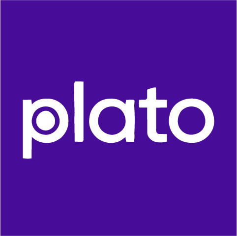

<p align="center">
  
</p>

# plato

An Open Source, AI-powered [microlearning](https://philosophers.group/platos-microlearning/) platform. Learners work through focused, exemplar-driven lessons in a continuous conversation with an AI coach that creates activities, evaluates submissions, and tracks progress toward mastery — all in under 20 minutes.

Built by [11:11 Philosopher's Group](https://github.com/1111philo).

Special thanks to [UIC Tech Solutions](https://it.uic.edu/), [UIC TS Open Source Fund](https://osf.it.uic.edu/), [WordPress](https://wordpress.org/), [Louisiana Tech](https://www.latech.edu/), and the [ULL Louisiana Educate Program](https://louisiana.edu/educate).

> **Looking to extend plato?** plato supports plugins like WordPress: add custom user fields, new admin KPIs, AI agents, lifecycle hooks, and more. Run `node scripts/create-plato-plugin.js my-plugin` to scaffold one in seconds, or read the **[plugin authoring guide](docs/plugins/AUTHORING.md)** (and the **[AI-agent guide](docs/plugins/AGENTS.md)** if you're working with Claude Code or similar tools).

## How it works

plato applies [microlearning principles](https://philosophers.group/platos-microlearning/) through AI-powered personalization. Each lesson is a focused experience designed to be completable in ~11 exchanges (~20 minutes), built around a single exemplar and 2-4 learning objectives.

A **lesson** defines an exemplar (the mastery-level outcome a learner produces) and a set of learning objectives. When a learner starts a lesson, an AI coach opens a conversation and guides them through activities — coaching, creating tasks, evaluating submissions (text or images), and tracking progress — all in a single continuous chat. The coach enriches a knowledge base as the learner progresses, adapting to their strengths and weaknesses until they achieve the exemplar.

### Microlearning pacing

Lessons are designed for completion within 11 exchanges (~20 minutes), but the system never cuts a learner off. The coach adapts its approach as exchanges accumulate — and always decides when the exemplar has been demonstrated. There is no hard cutoff and no forced closure.

| Exchanges | Coach behavior |
|-----------|---------------|
| 1-7 | Normal coaching — diagnostics, practice, assessment |
| 8-10 | Approaching target — converge toward the exemplar, prefer focused steps |
| 11+ | Past target — drop non-essential objectives, scaffold to the biggest remaining gap |
| 20+ | Well past target — the lesson probably mismatched the learner; coach flags it in `[KB_UPDATE]` but keeps moving them forward |

The admin dashboard tracks an **on-target rate** KPI showing what percentage of lessons complete within the 11-exchange target. A low rate means the **lesson design** or **coach prompt** probably needs tuning — not that pacing should be enforced more aggressively. Extended lessons (2× target or beyond) are surfaced as informational diagnostics, never as metrics to drive to zero.

The dashboard also tracks two **Learner Engagement** KPIs: percentage of learners who have **started** any lesson (target >90%) and percentage who have **completed more than half** of their available lessons (target >50%). Both come from `GET /v1/admin/stats/lessons`, which is stale-while-revalidate cached (~10 min freshness) so dashboard loads stay fast. A **Refresh** button on the dashboard bypasses the cache and recomputes synchronously.

Admins manage everything from `/plato`: lessons, users, a classroom customizer (styles + knowledge base), and plugins.

## Reporting issues

Issues and feature requests go in [GitHub Issues](https://github.com/1111philo/plato/issues). An automated intake agent reads every new issue and either:

- Tags it `ready-for-pilot` — enough detail is present, a maintainer or the pilot agent will pick it up
- Tags it `needs-info` and posts a few focused clarifying questions — reply inline when you can
- Closes it politely (with an invitation to reopen) if it's spam, off-topic, or abusive

To skip the `needs-info` round-trip, include upfront:

- The URL or page where it happened
- What you did (exact steps)
- What you expected vs. what actually happened
- Any error message, screenshot, or browser console output
- Your browser + OS, and whether you were signed in as a learner or admin

The intake agent only asks for things you can provide. It never asks you to inspect code — that's our job.

## Quick start

### Prerequisites

- Node.js 20+
- npm

### Setup and run

```bash
# Clone the repo
git clone https://github.com/1111philo/plato.git
cd plato

# Install dependencies (client and server)
cd client && npm install && cd ../server && npm install && cd ..

# Build the client (server serves the built files)
cd client && npm run build && cd ..

# Configure your environment
cd server && cp .env.example .env
# Edit .env with credentials for your AI provider (see "AI provider")

# Start the dev server (uses SQLite for data — no Docker needed)
node dev-sqlite.js
```

Open [http://localhost:3000](http://localhost:3000).

On first visit you'll name your classroom and create an admin account. Prompts and lessons are seeded automatically. The knowledge base is created by admins through the conversational KB Editor in the Customizer.

### Tests

Run `npm test` from the repository root for the client and server unit suites.
The admin responsive browser regressions use Node's test runner and the
[Playwright browser library](https://playwright.dev/docs/library):

```bash
npm ci
npm run build:client
npm --prefix client exec -- playwright install chromium
npm --prefix client run test:browser:admin
```

The browser suite starts and stops its own local server, creates a temporary
SQLite database and administrator, and removes its data afterward. It covers
short desktop windows, enlarged navigation text, short-phone scrolling and
keyboard navigation. It makes no AI requests. The client CI test job builds
the app, installs Chromium and runs this suite after the unit tests.

### AI provider

Open **Admin → AI Settings** (`/plato/ai`) to choose **Amazon Bedrock** or
**Cloudflare Workers AI**. The saved choice applies to all nine agents and
plugin AI calls on the next request, including streaming conversations and
lesson extraction. There is no automatic fallback to another provider.

- **Bedrock** is the default for existing installations. It uses
  `qwen.qwen3-vl-235b-a22b` and the server's standard AWS credential chain.
  Provide `bedrock:InvokeModel` / `bedrock:InvokeModelWithResponseStream`
  permissions and model access in `AWS_REGION` (default `us-east-2`).
  See the [Bedrock setup guide](https://docs.aws.amazon.com/bedrock/latest/userguide/getting-started.html)
  and [model access guide](https://docs.aws.amazon.com/bedrock/latest/userguide/model-access.html).
- **Workers AI** defaults to Cloudflare-hosted
  [DeepSeek V4.1 Flash 1017](https://developers.cloudflare.com/workers-ai/models/deepseek-v4.1-flash-1017/)
  (`@cf/deepseek-ai/deepseek-v4.1-flash-1017`) with **maximum reasoning**
  (`reasoning_effort: max`). It supports text and images and requires
  Workers Paid or prepaid AI Gateway credits. Mistral Small 3.1 24B is also selectable.
  After the server owner completes the [one-time OAuth setup](docs/CLOUDFLARE_OAUTH.md),
  select **Connect Cloudflare** to sign in and authorize an account in your browser.
  Plato stores the resulting tokens encrypted on the server and renews them as needed.
  Alternatively, set `CLOUDFLARE_ACCOUNT_ID` and `CLOUDFLARE_API_TOKEN` in `server/.env`
  or the server environment, then restart. A manual account-scoped token needs
  Workers AI Read and Edit permissions; see the
  [Cloudflare token setup guide](https://developers.cloudflare.com/workers-ai/get-started/rest-api/).
  OAuth and manual credentials are never returned to the browser or stored in the provider/model settings.

The **Active configuration** summary shows the saved provider, model, and Bedrock
region. **Pending changes** lists everything Save will persist, including a
Cloudflare model preference retained while Bedrock is selected. Use **Test
connection** to send a short inference request with the selected provider/model,
then **Save AI settings** to apply the changes. Test results identify the exact
configuration and record that request only; editing the selection clears them.
**Discard changes and reload** replaces the draft only after settings load
successfully. A failed reload keeps the draft.

After a browser connection, **Test connection**, then **Save AI settings** to apply
pending provider/model changes. Connecting an account does not select Workers AI
automatically. Manual environment changes require a server restart and **Reload settings**.
Learning administrators can share the setup checklist in the dashboard with their
server owner. Credential presence alone does not prove
model access, and a successful test is not an ongoing health guarantee. Tests incur normal
provider usage. Maximum reasoning can take longer; requests time out after
115 seconds and receive an extra 8,192 completion tokens for reasoning.

Before the first admin save, `AI_PROVIDER` (`bedrock` or `workers-ai`) and
`WORKERS_AI_MODEL` can set the initial defaults. Saved settings take precedence.
Without either, requests use Bedrock, so set `AI_PROVIDER=workers-ai` on a server
that has no AWS credentials. AI Settings warns when it finds none. An unrecognized
value fails every AI request; the server logs `ai_provider_error` with `stage: settings`.
For Lambda, supply the optional `CloudflareAccountId` and `CloudflareApiToken`
SAM parameters through your deployment secret configuration; both API and
streaming functions receive them. Do not commit tokens in SAM config files.
The historical Bedrock evaluation is in [`docs/MODEL_SELECTION.md`](docs/MODEL_SELECTION.md).

Then log in and navigate to `/plato` to see the admin dashboard, or `/lessons` to start learning.

## Project layout

```
plato/
  client/                React 19 + Vite SPA (learner and admin UI)
  server/                Node.js + Hono + AWS Lambda + DynamoDB (API, auth, data, AI proxy)
  plugins/               Built-in and community plugins (e.g. plugins/slack)
  packages/plugin-sdk/   TypeScript types for plugin authors
  docs/plugins/          Plugin authoring docs (start at AUTHORING.md or AGENTS.md)
  scripts/               Build, deploy, and plugin scaffolding tooling
  docs/                  Extended guides (deployment, etc.)
```

For architectural details (AI agents, data model, auth, conventions) see [CLAUDE.md](CLAUDE.md).

## Extending plato

There are two contribution paths and they have different review bars:

**Build a plugin (most common).** Plugins live in `plugins/<id>/` and have a lighter review bar — they sit alongside core, declare what they touch via capabilities, and can't override completion semantics or other core invariants. Scaffold a working plugin with:

```bash
node scripts/create-plato-plugin.js my-plugin --name "My Plugin"
```

Then read [docs/plugins/AUTHORING.md](docs/plugins/AUTHORING.md) (humans) or [docs/plugins/AGENTS.md](docs/plugins/AGENTS.md) (AI agents). The full extension reference is at [docs/plugins/EXTENSION_REFERENCE.md](docs/plugins/EXTENSION_REFERENCE.md). Plugins can add admin pages, custom settings UI, server routes, lifecycle hooks, and more.

**Contribute to plato core.** Anything outside `plugins/` is core — coach, lessons, KPIs, agents, the plugin host itself. See [CONTRIBUTING.md](CONTRIBUTING.md) for setup and review process; [CLAUDE.md](CLAUDE.md) for architecture context. Core changes require more review than plugin changes because they affect every plato deployment, including the public plugin contract.

## Deployment

For production deployment to AWS — SAM setup, CI/CD from a private fork, custom domains, backups — see **[docs/DEPLOY.md](docs/DEPLOY.md)**.

## Accessibility

plato is designed to be fully usable with screen readers (VoiceOver, NVDA, JAWS) and keyboard-only navigation. The AI chat follows the [MITRE Chatbot Accessibility Playbook](https://mitre.github.io/chatbot-accessibility-playbook/) and [Orange accessibility guidelines](https://a11y-guidelines.orange.com/en/articles/chatbot/): silent-by-default chat log, controlled announcements for new messages, keyboard navigation between messages (`Alt+ArrowUp`/`Alt+ArrowDown`), and `Cmd/Ctrl+Enter` to send. Implementation details live in [CLAUDE.md](CLAUDE.md).

Mobile controls use larger hit areas for coarse pointers, and dialogs scroll within the available viewport. The admin menu uses the shared modal primitive for focus containment, Escape dismissal, and focus return. Streaming coach content stays inert while a response is streaming; rejected lesson sends restore the editable draft. Completion feedback respects reduced motion. Configurable branding derives a readable foreground from contrast ratios.

Run `npm test` and `npm run build:client` for regression checks. Mobile QA also needs physical iOS Safari and Android Chrome checks for virtual keyboards, browser chrome, autofill, zoom, native gestures, and screen readers; desktop emulation does not verify those behaviors.

## Contributing

Plugins live in `plugins/` and have a lighter review bar — see [docs/plugins/AUTHORING.md](docs/plugins/AUTHORING.md). Core changes (anything outside `plugins/`) follow [CONTRIBUTING.md](CONTRIBUTING.md). The `main` branch is protected — all changes require a pull request.

## License

Copyright (C) 2026 [11:11 Philosopher's Group](https://github.com/1111philo)

This program is free software: you can redistribute it and/or modify it under the terms of the [GNU Affero General Public License v3.0](LICENSE) as published by the Free Software Foundation. Modified versions that are accessible over a network must also be made available under the same license.
