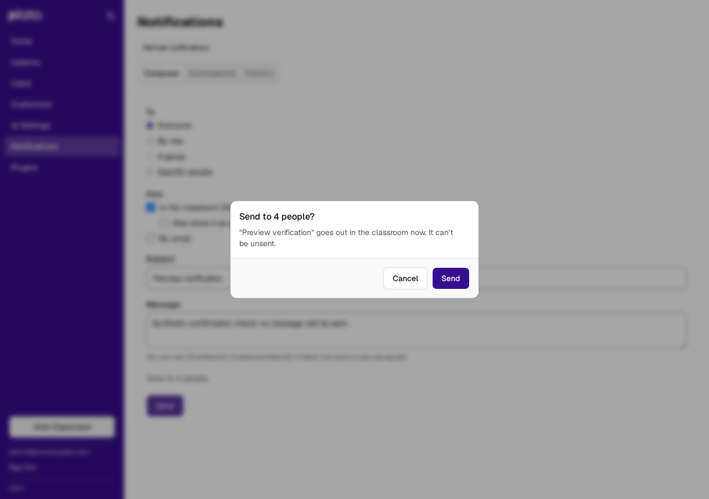

# Launch integration closeout — 2026-11-06

The approved fresh-install launch integration is complete on
`feat/upstream-launch-integration`, delivered through
[draft PR #43](https://github.com/henryperkins/googleplato/pull/43).
The candidate includes fork main `bdcc598` and upstream playground
`1105f34`. The final published SHA is recorded in the PR and the private
publication proof. Main merge and production deployment are later stages.

## Result

The integrated app adds educator/tester/learner roles, Course → Unit → Lesson
organization, split names, account-invite consent, improved admin tables,
notifications, learner notes, lesson overviews and agent-activity disclosure,
chat preferences and the three-lesson Getting Started course. It retains the
fork's optional Google-auth plugin, selected AI providers, server-owned
assessment, signed turns, atomic transcript/progress saves and recovery.

The complete upstream review exposed two remaining defects in the existing
integration candidate; both now have regression coverage and independent
review approval:

- Invitation acceptance re-reads the current profile and conditionally commits
  its fill-only merge on SQLite, PostgreSQL and DynamoDB. Concurrent profile
  edits force recomputation. Five unsuccessful comparisons return 409 with the
  invitation pending; deleted accounts are not recreated. The response/audit
  report only fields actually filled.
- Notification Send requires a successful preview for the exact current
  audience selection. Pending, failed and obsolete previews cannot reuse an
  earlier count. The confirmation dialog and POST use the same reviewed
  audience and message snapshot.

The notification initial-claim, definite-failure retry, uncertain-send and
same-request dispatch-recovery fixes were checked against the later review.
Learner-note serialization and the signed assessment/save pipeline were also
verified. Optional AWS workflow session names are retained with fork-accurate
account documentation; the root lock resolves follow-redirects 1.16.2 and
@hono/node-server 2.1.5. Separate agreement, ping and historical prototypes
remain outside the launch integration.

## Fresh-install evidence

An actual `server/start.js` process initialized a unique empty schema on the
dedicated local PostgreSQL 17.11 helper. Network HTTP checks verified the
Course, Unit and all three public bundled lessons, each lesson's placement,
split names, account-bound invitations, View-As guards/CORS, unsubscribe,
awaited jobs and same-request notification retries. Only task-created schemas
were removed afterward.

Fresh-install qualification requires no historical learner-data conversion,
backfill project or upgrade rehearsal. The retained initialization/migration
machinery remains idempotent. Existing authored content, settings, databases
and unrelated work were preserved.

## Final validation

| Check on the amended candidate | Result |
| --- | --- |
| Full server suite, including real PostgreSQL 17 | 1,252 passed; zero failures or skips |
| Full client unit suite | 863 passed; zero failures or skips |
| Complete application Playwright suite | 117 passed across desktop and mobile |
| New deterministic audience browser suite | 4 passed; original component failed all four |
| Focused invitation/storage/runtime regressions | 64 passed; real SQLite/PostgreSQL plus controlled DynamoDB |
| All plugin server test files | 25 passed |
| Plugin manifests | All four valid |
| Client production build | Passed; existing chunk-size advisory |
| Root lint | Zero errors; 24 existing client warnings; server clean |
| Independent closeout specification/quality review | PASS / Approved; no actionable P1/P2 findings |
| Primary checkout preservation | All 16 dirty-file hashes and primary index bytes unchanged |

Earlier whole-candidate review and browser evidence remain valid for unchanged
code. The closeout reran the full application suite and affected rendered
regressions; earlier results are not counted as new execution.

GitHub Actions jobs could not start because the account is locked by a billing
issue. The passing results above are local checks, distinct from hosted CI.

## Synthetic HTTPS preview

[Open the preview](https://googleplato-upstream-preview.hperkins.com/).
The task-owned service was restarted on the reviewed source and rebuilt
client. HTTPS root, health and the built asset returned 200. A newly invited
synthetic learner signed up and signed in, completed a mock SSE response and
persisted a signed atomic completion. Desktop, 390 px and 320 px checks found
no horizontal overflow or page errors. Notification Send stayed disabled
while the current real-backend preview was delayed, then confirmed the
current four-person audience; the dialog was cancelled and no message sent.

The preview uses a dedicated SQLite database, mock AI and disabled email.
Slack auto-invite is off. Synthetic access details, screenshots, logs and
publication proof are kept outside the repository in
`/home/ubuntu/.local/state/googleplato/integrations/20261106T182556Z-fresh-launch`.
Existing preview data was not reset.

## Evidence boundaries

The database and HTTP evidence is local execution; the HTTPS browser evidence
uses the synthetic preview. DynamoDB uses a controlled SDK transport.
No production Cloud Run/Cloud SQL release, live Google sign-in, real AI/email/
Slack delivery, hosted Lambda/DynamoDB, physical-device or assistive-technology
qualification is claimed. Invitation profile mutation, invite consumption and
audit remain separate operations, preserving the pre-existing later-step
failure boundary.
