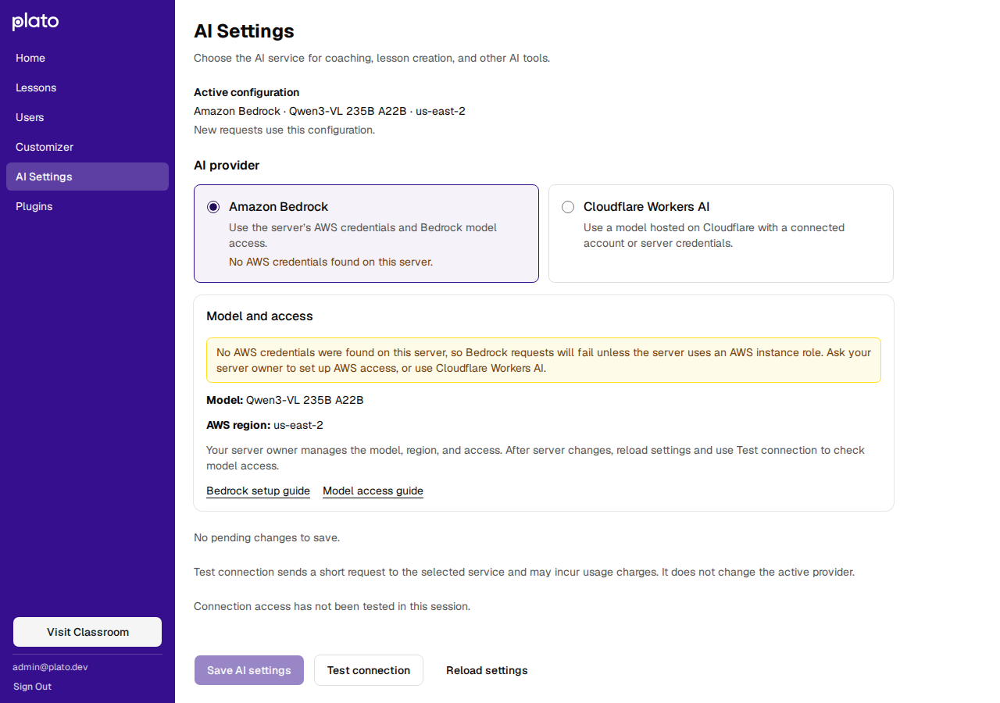
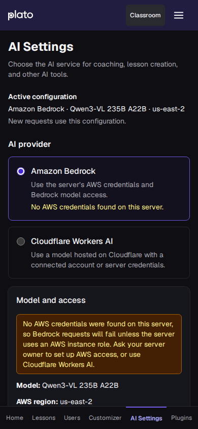

# AI failure diagnostics verification

This change logs why AI requests fail, reports credential failures with
honest codes, keeps the Cloudflare connection when a token renewal never
reached Cloudflare, and warns in AI Settings when Bedrock has no AWS
credentials. It changes no prompts, models, reasoning settings or completion
rules, and it makes no paid model calls in tests.

## Tests

Local validation on Node 24 passed: 501 client tests and 691 server tests,
with zero skips using a disposable PostgreSQL 17 instance. Lint reported zero
errors and 20 existing client warnings, none in files this change touches.

The Cloud Build test gate was reproduced from a `git archive` export of the
branch head: `npm ci && npm run lint && npm test` in `node:24-bookworm-slim`
against `postgres:17-bookworm` on a user-defined Docker network. The results
matched.

Restoring the previous behavior in `cloudflare-oauth.js` (every credential
failure reported as Reconnect, and every failed renewal disabling the
connection) made three new tests fail: the busy lease, the database read
failure and the renewal that never reached Cloudflare.

## Fetch failure shapes

The "never reached Cloudflare" rule depends on how Node 24's `fetch` reports
network failures. These shapes were observed locally against a closed
localhost port and an unresolvable `.invalid` host, with no external requests:

| Failure | `fetch` rejection |
| --- | --- |
| Refused connection | `TypeError`, cause `ECONNREFUSED` with `syscall: 'connect'` |
| Refused on every address (Happy Eyeballs) | cause `AggregateError`, `code: 'ECONNREFUSED'`, each inner error with `syscall: 'connect'` |
| Unresolvable host | `TypeError`, cause `ENOTFOUND` |
| `AbortSignal.timeout` | `TimeoutError` with no cause; treated as ambiguous |

Only failures from the host lookup or the connect attempt, on every address
tried, count as never sent. A timeout, a reset after connecting, a redirect or
any HTTP response still disables the connection, as before.

## AI Settings warning

Headless Chromium against a local SQLite server whose environment has no AWS
credentials. The warning appears on the Bedrock option and in its card. Checked
on a light desktop and a dark 390 px viewport, with no horizontal scroll.

With Workers AI active, selecting Bedrock made **Save AI settings** use
`aria-describedby="ai-pending-changes bedrock-credentials-warning"`, both
elements present, and the button stayed enabled: the check warns and never
blocks, because it cannot see an EC2 instance role. Selecting Workers AI
removes the card warning. This was headless Chromium only, not Safari, Firefox
or a physical device.

## Not verified here

No Cloud Run deployment or production log query was part of this check. The
first production `ai_provider_error` events will show the cause of the Workers
AI failures that previously logged only `ai_unavailable`.
