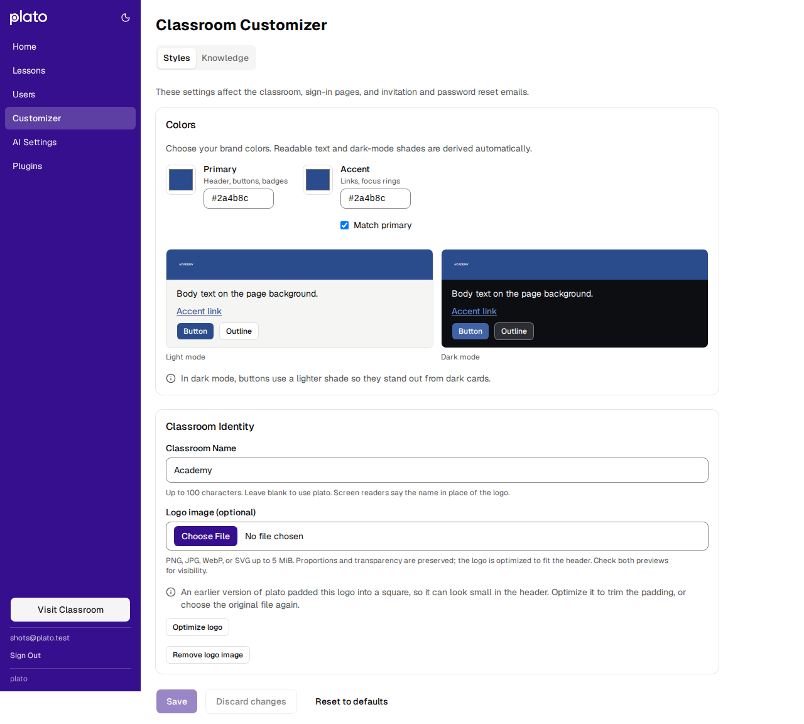
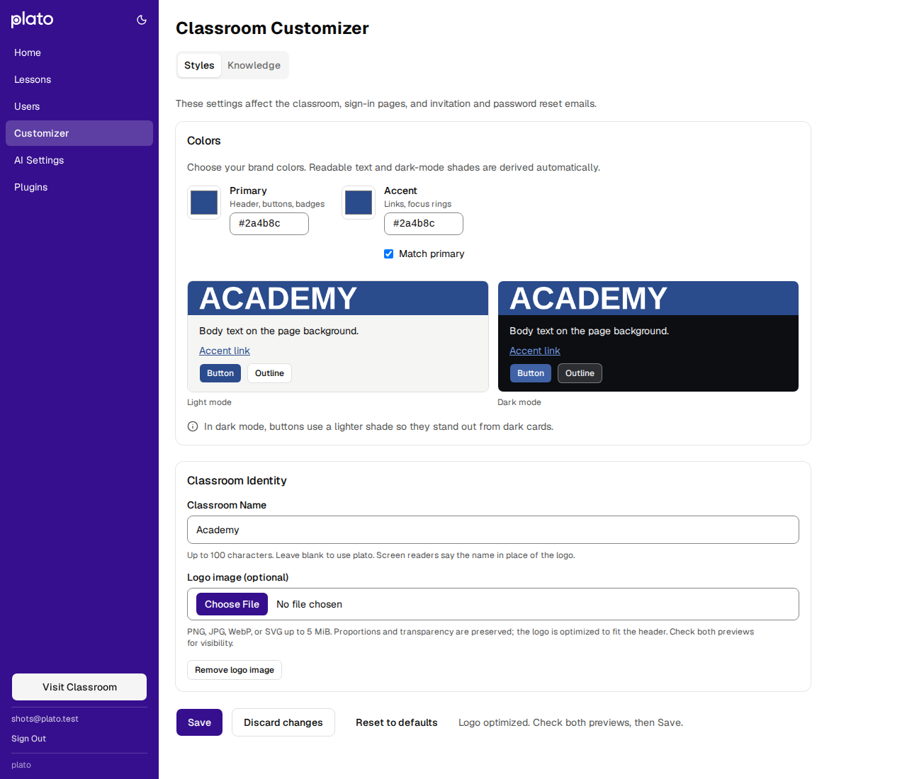
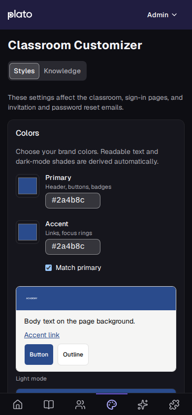

# Classroom Customizer follow-ups — 2026-10-25

This report records the initial PR #23 follow-up at `fb179f9`. Its stored-SVG,
asset cleanup, color-patch and reset-response policies are superseded by the
[readiness follow-up](classroom-customizer-readiness-2026-10-25.md), which includes
the final validation and recovery screenshots.

Follow-up to [classroom-customizer-remediation-2026-10-25.md](classroom-customizer-remediation-2026-10-25.md)
(commit `e2ce942`). That commit was checked against the original Customizer
review by independent reviewers in Chromium, WebKit and Firefox and against the
SQLite, PostgreSQL and DynamoDB adapters. A second round then reviewed these
fixes. Each gap below was reproduced before it was fixed, and each fix has a
regression test that fails on `e2ce942`'s code.

## Logos

| Gap | Fix | Tests |
| --- | --- | --- |
| Logos saved by earlier versions over 128 KiB, or SVGs with design-tool markup (`<style>`, metadata, DOCTYPE, editor namespaces), stopped showing at deploy, and the next save deleted them. | Stored logos are read by looser rules than uploads: up to 8 MiB, and any SVG without entity declarations; they only render through `` and the logo endpoint sandboxes direct navigation. The next save moves an inline logo into an asset marked `legacy`. A value that can't be shown is kept until the logo is replaced or removed. | `branding.test.js`: earlier-version PNG, design-tool SVG, large SVG, unshowable inline value |
| Raster logos the old pipeline padded into 512 × 512 squares still looked tiny in the header. | The Customizer notes them and **Optimize logo** trims the padding (rasters only; SVGs were stored unchanged). | Browser: earlier-version logo optimized; earlier-version SVG gets no offer |
| A small strict-valid SVG could expand through `<use>`, aliased XLink prefixes, duplicate ids, or mask/clip/pattern chains and block every visitor's page. | References are counted the way browsers instantiate them, duplicate ids are refused, and new uploads may render at most 10,000 elements. | `branding.test.js`: expansion, every kind of reference |
| A 4096 × 4096 upload within 128 KiB decoded to 64 MiB per visitor. | New uploads are also capped at 1024 × 1024 pixels in area. | `branding.test.js` |
| Replaced or removed logos stayed publicly fetchable. | The previous asset is deleted after a successful save. Uploading the current logo again stores it if its asset is missing. A save that conflicts leaves its new, never-published asset for the retry. | `branding.test.js` |
| SVGs were rasterized at their intrinsic size (soft on dense screens); a huge intrinsic size gave a blank logo; an untyped `.svg` file couldn't be read; large reductions aliased in WebKit and Firefox. | Vectors fill the 1024 × 128 box and are drawn once; untyped SVG files are read as SVG; rasters shrink in halving steps; a blank result is refused. | `logoUpload.test.js`, browser |
| A logo request that failed showed a broken image in place of the name. | The header and all six sign-in pages fall back to the classroom name. The favicon falls back to the name's initial, which also replaces logos wider than 2:1. | Browser |

A raster logo saved by an earlier version, before and after **Optimize logo**
(desktop light; phone dark):

## Server writes and email

| Gap | Fix | Tests |
| --- | --- | --- |
| A name with a lone surrogate was stored; every invitation and reset email then threw, and password reset failed only for existing accounts. | Names must be well-formed text. Reads cut by code point and repair legacy names, and email text is made well-formed before encoding. | `branding.test.js`, `email.test.js` (through the real SES client) |
| Both first-run setup routes saved unchecked names and still had the old red-accent default; the raw `PUT /v1/admin/settings` merge accepted branding fields. | Setup uses the Customizer's name check and the primary-matching default; the raw merge refuses branding fields. | `auth.test.js`, `branding.test.js` |
| The theme save read settings with an eventually consistent read on DynamoDB. | The read is strongly consistent. | `branding.test.js` |
| The email footer was 2.85:1; near-white brands lost the header and button edges; every sender name was base64 encoded; a `Name <address>` sender setting produced an invalid Source. | The footer is #666; brands under 3:1 on white get visible edges; plain names are sent as before, other ASCII is quoted, the rest is encoded; only the address of the setting is used. | `email.test.js` |
| The Slack invite DM inserted names without escaping Slack's control characters. | Names are escaped. | `slack-plugin.test.js` |

## Styles tab

| Gap | Fix | Tests |
| --- | --- | --- |
| After a shorthand hex, the first press on Save, Remove, Optimize, Discard, Reset or the file field was lost: committing the value reflowed the notes under the pointer. | Pressing those controls keeps focus in the hex field; Save commits the value itself. | Browser |
| The color notes weren't the color fields' description: the list's `aria-label` replaced its text. | The always-mounted live container has no `aria-label`. | Browser (Chromium accessibility tree), contract |
| A saved accent equal to the primary loaded as independent; unmatching jumped to a stale color; edits that publish nothing counted as unsaved; Save resent every field, including the logo, overwriting other admins' changes. | Equal accents are Match primary; unmatching starts from the shown color; drafts compare by what they publish; Save sends only changed fields and then reloads the saved styles. | `stylesDraft.test.js`, browser |
| A hex value without `#` was rejected. | Accepted. | `stylesDraft.test.js`, browser |
| The previews added six dead tab stops. | The samples are inert. | Browser |
| Discard, Reset and a prepared logo weren't announced; a navigation held during a save stayed on a dialog that claimed unsaved edits; Retry and a successful Optimize dropped focus. | Each is confirmed in the status line; the held navigation proceeds once the save lands; Retry keeps focus until the content replaces it, then the heading takes it; Optimize hands focus to Save. | Browser |
| Pages without a theme control ignored later device light/dark changes. | `main.jsx` keeps one theme subscription for the page's life. | Browser, `theme.test.js` |

`CLAUDE.md`, `DESIGN.md`, `docs/ARCHITECTURE.md` and the design-token sidecar
were updated to match, including the device-following theme default and the
favicon.

## Validation

| Check | Result |
| --- | --- |
| Client unit tests | 535 passed |
| Server tests | 749 passed, 2 skipped (PostgreSQL not configured) |
| Server tests with `POSTGRES_TEST_URL` (disposable `postgres:17-bookworm`) | 762 passed |
| Customizer browser suite, Chromium and WebKit | 17 passed each |
| Customizer browser suite, Firefox (temporary copy launching Playwright's Firefox build 1555) | 17 passed |
| `npm run lint` | 0 errors; the 20 existing client warnings |
| `node scripts/validate-plugins.js`, `npm run build:client`, `git diff --check` | Passed |

Not covered: live SES delivery, a real DynamoDB table, assistive technology,
and physical devices. Sending back the current logo unchanged is accepted only
within the request size limit (128 KiB of logo data); clients should omit an
unchanged logo, as the Customizer does.
