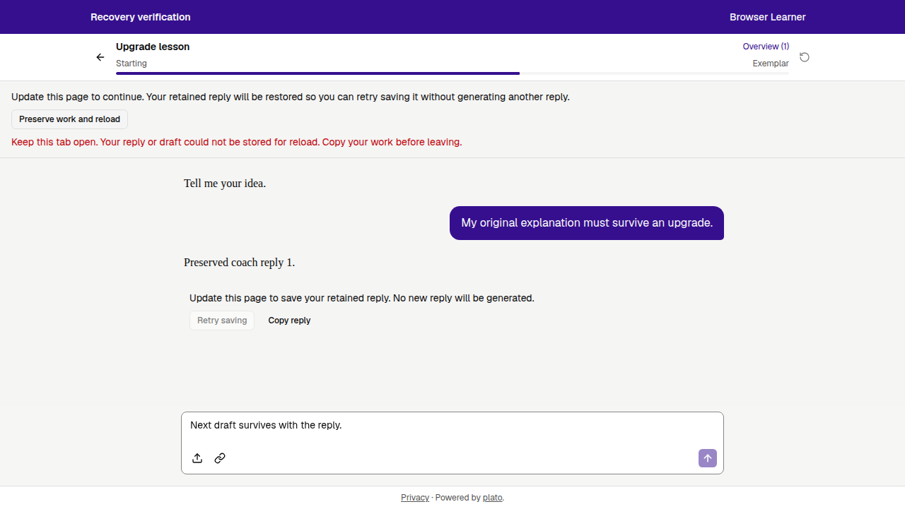
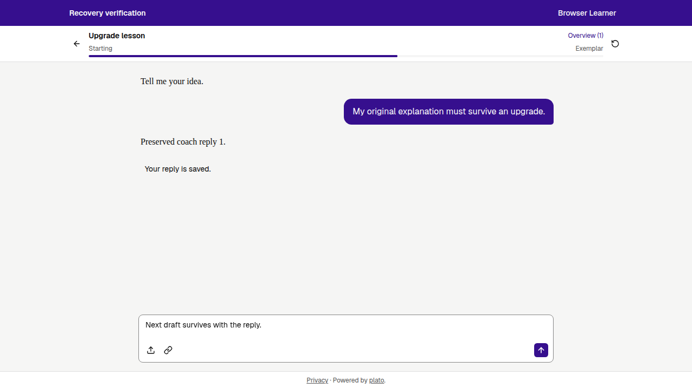

# Client upgrade fencing and learner recovery

Date: October 20, 2026 (America/Chicago). Implementation base: `498c30f`.
This is a local implementation and validation record, not a deployment record.

## Result

Stale clients receive a deterministic `409 client_upgrade_required` before
mutating sync state, invoking lesson-start plugins, or calling an AI provider.
Compatible pages negotiate protocol `1` and a server epoch once; the epoch and
upgrade block survive SPA account changes and logout. A fresh page is required
to negotiate again. Authentication and recovery reads remain available.

Single and batch generic writes now require explicit, valid versions and use
strict database conditions. Version `0` creates only an absent record; a positive
version updates only an existing match. The client no longer fetches a newer
version and resends an old payload after a conflict. Rejected deletions retain
the local cache. Screenshot creation can acknowledge identical immutable content
through a fresh server read, allowing interrupted legacy-image migration to
resume without overwriting a colliding screenshot.

The lesson upgrade action checks all in-flight generations in the page and
verifies readable local copies of every retained reply and draft, including
previously visited lessons and accounts. A failed local write keeps the tab open.
Draft text, images, and link context use account-scoped recovery keys. After
reload, the original generated turn is restored and **Retry saving** submits its
original IDs and base snapshot without calling a model or reapplying coach tags.
Token refresh also compares the captured session before storing credentials or
reporting expiration, preventing a late response from affecting another account.

Firestore reads, cache backfills, and subscription updates were disconnected from
`loadAll`: granting compatibility to mirror-derived cached state would defeat the
fence. Mirror writes, Google profile side effects, the Firebase SDK, and Firestore
rules remain for the separate retirement cutover. No production settings,
database contents, infrastructure, billing, or rules were changed by this slice.

## Validation

- Baseline: **891 tests passed**, with real PostgreSQL checks enabled.
- Final `npm test`: **924 passed** — 377 client and 547 server; zero failures,
  cancellations, or skips. PostgreSQL 17 ran locally in a disposable container,
  with isolated test schemas. The suite includes a real production-server CORS
  preflight with the compatibility headers.
- `npm run lint`: passed with zero errors and 20 existing client warnings;
  server lint passed. The baseline had 21 client warnings.
- `npm run build:client`: passed. `git diff --check`: passed.
- Independent review identified and then verified fixes for cross-lesson reload
  loss, account-switch epoch rebinding, interrupted image migration, and stale
  token refresh. The follow-up ran 49 focused tests and repeated the original
  memory-only recovery and real Hono/SQLite image-migration reproductions, with
  no remaining actionable findings.

Regression coverage includes missing/old/future protocol headers, epoch changes,
both AI response modes, rejected writes before effects, strict create/update
conflicts, invalid batch metadata, failed deletion, canonical cache hydration,
storage quota/readback failures, draft attachments, account switches, generation
in another lesson, retained replies from another account, lost acknowledgements,
and zero additional model calls during recovery, including optional enrichment.

Browser validation used Chromium against the actual Vite UI with controlled API
fixtures; it made no real model calls or production writes:

1. An epoch changed after one generated reply. Its save was rejected, the reply
   stayed visible, and further Send/Retry saving actions were disabled until
   upgrade. A forced browser-storage failure blocked reload and showed a warning.
2. Restoring storage and choosing **Preserve work and reload** recovered both the
   reply and next draft. **Retry saving** committed the original turn; AI request
   count remained **1**, with three total conversation messages.
3. A second generated reply committed but lost its acknowledgement. The epoch
   then fenced its retry. Reload and save-only recovery left AI request count at
   **2**, five conversation messages, and both message/progress versions at **3**.
   No duplicate turn or progress update occurred.

## Rollout boundary and limits

`CLIENT_COMPATIBILITY_EPOCH` defaults to `1`. Every serving instance and compatible
rollback build must use the same value. Do not assign an epoch per revision;
change it only for a coordinated upgrade. Deploying this gate will reject legacy
clients without headers. Before the broader Firestore cutover, repeat the named
database inventory and prepare a server-only rollback, as specified separately.

The new recovery UI cannot appear inside an already-loaded legacy bundle. Its
existing account-scoped generated-turn journal remains compatible after a manual
reload. Old lesson-only compose drafts have no account identity and are left
untouched; learners should copy that unsent text before upgrading a legacy tab.
Recovery is limited to the same browser tab/session. If storage is unavailable,
keep the tab open and copy the work. Physical-device and live production behavior
were not exercised by this local slice.

The implementation is isolated on `fix/client-upgrade-recovery` in the release
worktree. The original OAuth workspace and its unrelated untracked review,
planning, and browser artifacts were excluded.

## PR integration review — October 21, 2026 (UTC)

[PR #5](https://github.com/henryperkins/googleplato/pull/5) integrates the slice
with main `1f5b05e`, preserving its Cloudflare OAuth changes, immediate logout,
session generation, and account-scoped composer drafts. The original validation
above remains the record for implementation base `498c30f`.

Review and conflict resolution added these safeguards:

- Migrate the existing account-scoped `plato_compose_draft_v2` text format to
  rich drafts only after verified readback. Failed storage writes retain the old
  copy, and explicitly empty rich drafts cannot resurrect stale text.
- Retain main's immediate logout and sibling token-refresh reuse while checking
  both session generation and captured credentials. A response pending across
  logout and re-login as the same account is rejected.
- After protocol negotiation is rejected, permit recovery reads without repeated
  status handshakes while continuing to block mutations.
- Use nullish coalescing for conflict response versions, preserving any explicit
  numeric value without enabling automatic overwrite retries.

The integrated tree passed **992 tests** — 407 client and 585 server — with zero
failures or skips, including real PostgreSQL 17 tests in an isolated local
container. Lint passed with zero errors and 20 existing client warnings; the
client build and both staged and unstaged diff checks passed. An independent
reviewer ran 73 focused tests and approved the upgrade/recovery scope with no
newly introduced blocking findings.

Chromium repeated the three controlled-API browser scenarios above against the
integrated Vite application. Save-only recovery kept AI requests at **1 → 1**;
lost-acknowledgement recovery kept them at **2 → 2**, with five messages and both
record versions unchanged at **3**. Storage failure blocked reload and preserved
the displayed reply and next draft. These checks used synthetic data and no real
model calls or production writes.

The review also reproduced a **pre-existing** operation-wide account-ownership
gap on `498c30f`, main `1f5b05e`, feature `8416622`, and the integrated tree:
switching accounts during an awaited context read can send the original account's
lesson context to the model using the next account's credentials. The pending
turn is still retained for its original owner and cannot be saved as the new
account. [Issue #6](https://github.com/henryperkins/googleplato/issues/6) tracks
binding generation, automatic retries, and queued enrichment to the initiating
session. This PR does not claim to resolve that separate generation boundary.

This addendum records local review and validation. Hosted checks, merge status,
and their exact commit identities are recorded on the PR. No deployment,
Firestore rules change, or production-data change is part of this review.
