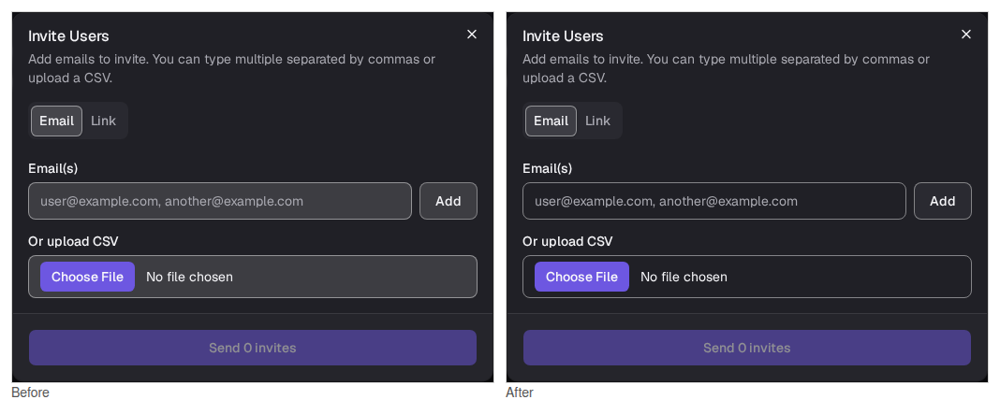
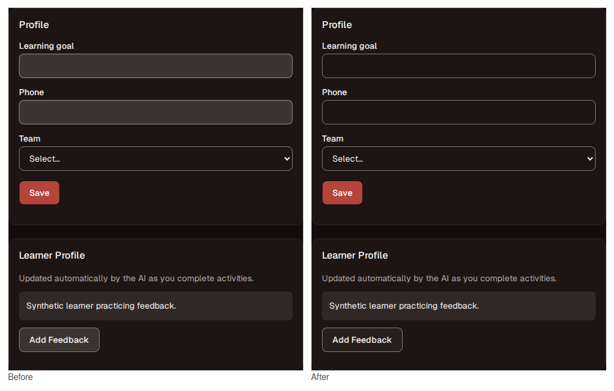
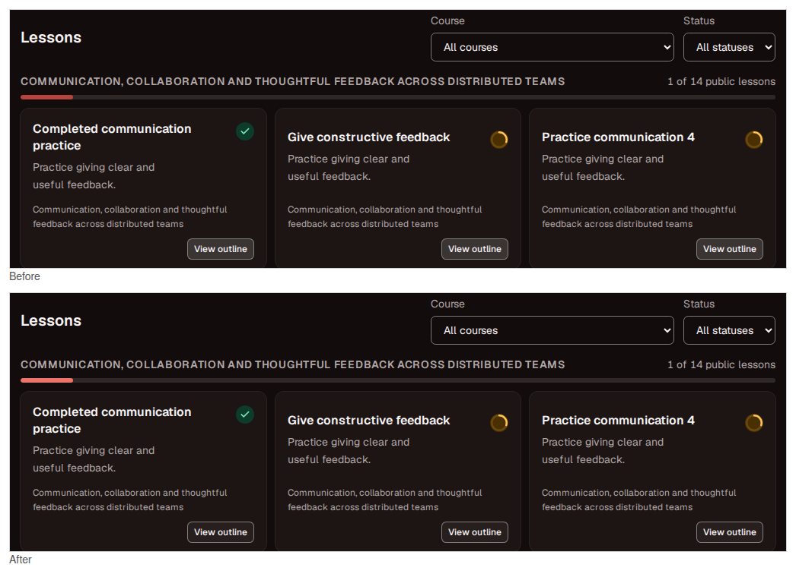
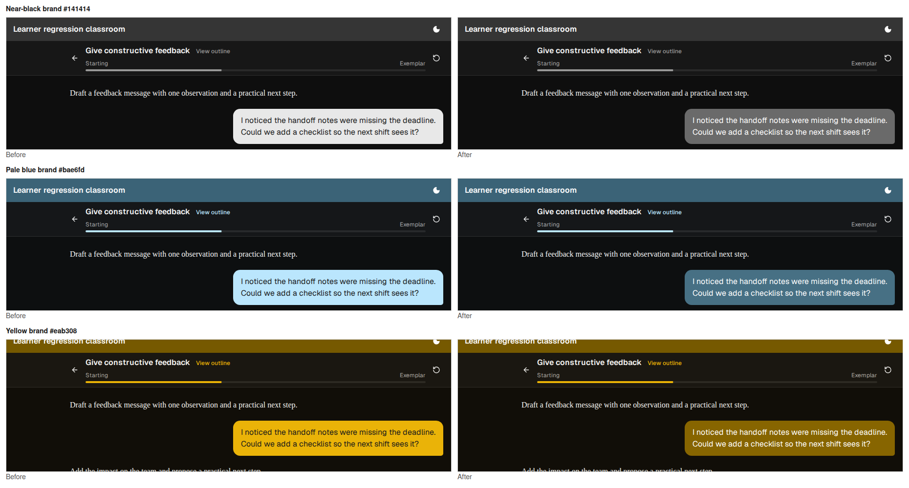
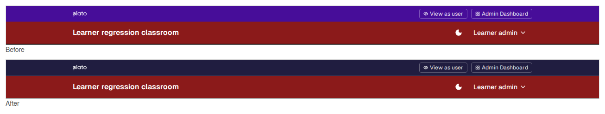
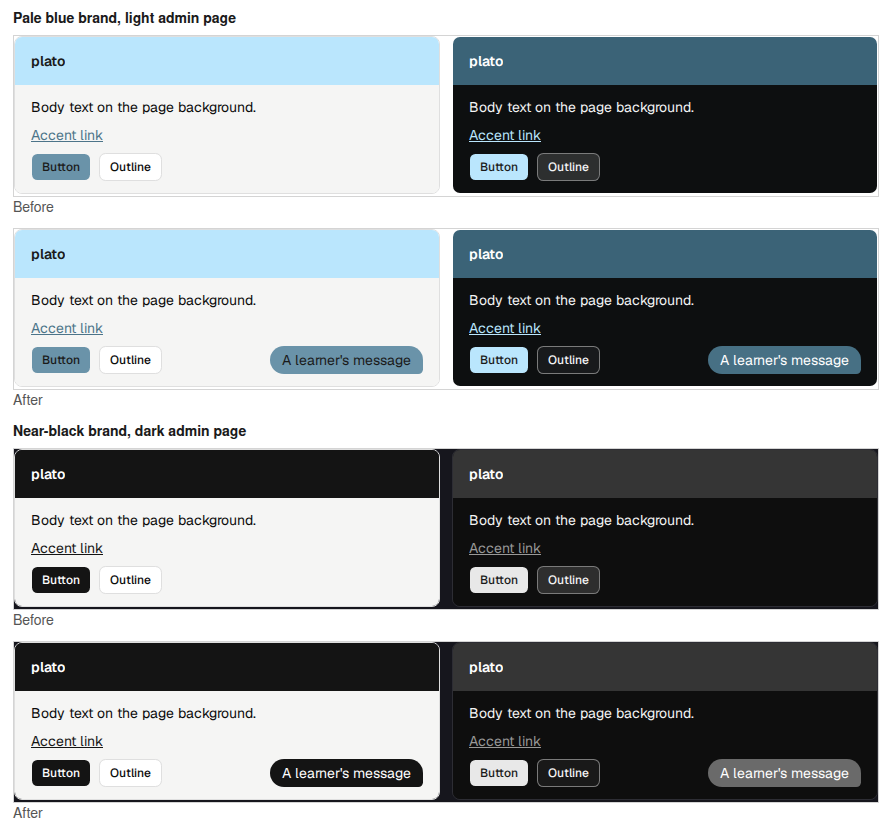

# Dark mode fills, progress, and learner bubbles

This pass checks a dark-mode audit against the code and the rendered pages, then fixes the findings that held up. Each claim was measured first: OKLCH lightness and WCAG contrast from `client/src/lib/branding.js`, translucent fills composited the way the browser paints them, and Chromium screenshots. The baseline is `main` at `ea65f3f`.

## Changed

**Fields, outline buttons, and the selected tab no longer take their dark fill from `--input`.** `--input` became 45% white so field borders hold 3:1 (WCAG 1.4.11). The shadcn fill `dark:bg-input/30` was tuned for a 15% border, so it became 13.5% white. That put fields at OKLCH lightness 0.33 on cards and 0.37 in dialogs, brighter than the menus (0.245) and highlighted rows (0.3) above them, while native selects beside them stayed transparent. Fields are now transparent in both themes; their border holds at least 4.3:1 on the page, cards, and dialogs at any classroom hue. Outline buttons lift one step off their surface with a 5% wash of the text color, or 10% on hover and while open. The old dark fill also outranked `aria-expanded:bg-muted` (selector specificity 0,3,0 against 0,2,0), so an outline menu trigger showed no open state at night. It now does. The selected tab keeps its input border over a 10% wash.

**Course summary bars fill with `primary-text`, like every other progress bar.** The button fill measured 2.65:1 against the night track for the default maroon, plato purple, and blue classrooms (2.82:1 unbranded), below the 3:1 that 1.4.11 asks of a progress indicator. It is now at least 5:1. The existing test only checked bars with the `progress-fill` class, which this bar lacks; it now checks every bar in the lesson list.

**Learner bubbles get their own token, `--bubble`.** By day, and at night for most brands, it is the fill. At night a classroom whose fill carries dark text (a pale brand kept as chosen, or the light gray a near-black brand turns) filled each message, up to 85% of the chat's width, at 10–18:1 against the page. Those bubbles now deepen to the darkest shade of the brand that still holds 3:1 against a dialog, and every night bubble carries white text (at least 4.67:1 across the 216-color sweep). Buttons keep their fills, including the deliberate light-gray inversion for near-black brands. The Customizer previews a bubble beside its sample buttons and adds a color note when the bubble deepens. The live default maroon and unbranded classrooms render byte-identical chat screenshots before and after.

**The classroom admin strip follows the dashboard at night.** It kept its day purple above the night header (1.21:1 against the unbranded night header). By day it keeps the admin-bar purple. At night it takes the dashboard's dark `sidebar` purple, with a hairline above the classroom header.

## Not changed

| Proposal | Reason |
| --- | --- |
| Lower `--muted`/`--secondary` to 0.255 and `--accent` to 0.28 | Tab tracks, chips, and dialog footers on a dialog (0.245) would fall from 1.12:1 to 1.03:1, and the highlighted menu row from 1.19:1 to 1.11:1. The progress bar that motivated it is fixed at the fill. |
| Deepen `--workspace` to 0.145, `--border` to 13%, `--input` to 42% | Matters of taste, not defects. The card-colored chrome on the page already has a ring or border. Decorative borders match light mode (1.32:1 against 1.33:1). A 42% `--input` would only shrink the margin of a tuned 3:1 border. |
| `disabled:opacity-100` on the Send button | The faint resting state was chosen in f4254b6 and matches light mode. WCAG exempts disabled controls, and a full-strength arrow would read as enabled. |
| Border and stronger fill on code blocks | Not dark-specific: 1.13:1 at night, 1.11:1 by day. |
| Dark `--chart-3` to `--chart-5` | No component uses the chart tokens. |
| Bottom border on the night header | Its 1.5:1 band against the page is the documented rule. |

## Rendered evidence

Captures use the production client build at 1280 px in Chromium's dark theme, with synthetic data in an isolated SQLite server: the learner regression fixture for the classroom, and `server/dev-sqlite.js` for admin pages. Before captures come from `main` at `ea65f3f`.

| View | Capture |
| --- | --- |
| A dialog's fields, outline button, and tabs |  |
| Settings: text fields beside a native select, and an outline button |  |
| Course summary bar and outline buttons, default maroon |  |
| Night bubbles for near-black, pale blue, and yellow brands |  |
| Classroom admin strip |  |
| Customizer previews, in a light and a dark admin page |  |

## Validation

- 707 client and 865 server tests passed (3 environment-gated skips). The PostgreSQL suite wasn't run; no server code changed.
- Client and server lint passed, with the 20 existing client warnings.
- Chromium browser suites passed: Customizer 26, admin 23, learner 19. The Customizer suite's rendered-contrast test now also measures `--bubble` for four palettes in both themes and requires white night bubble text.
- The new contract tests fail against `main`: the bubble tokens, no control fill from `--input`, and the course bar's fill.
- One Customizer regression presses Save by its coordinates at 1440 × 1000. A first layout put the bubble sample on its own line, which pushed Save 40 px below the viewport. The sample now shares the sample buttons' row, so the page keeps its height.

## Second pass: making the night palette worth using

The first pass fixed contrast defects, but the rendered night theme still read as muddy and flat, so this pass retunes the palette itself (no component markup changes beyond what the first pass did):

- **Surfaces go nearly neutral.** The brand tint in night surfaces drops from OKLCH chroma 0.012 to 0.007 (`tintChroma` cap and `--tint-chroma`), so a maroon classroom no longer tints the whole room brown nor a yellow one olive; the brand lives in the header and fills. The ramp deepens and spreads slightly (page 0.15, card 0.195, popover 0.235, muted 0.27, accent 0.29), body text softens from 0.97 to 0.95, secondary text rises from 0.74 to 0.76, and `--border` strengthens from 10% to 13% white so cards and separators carry their separation without shadows.
- **Lifted brand shades ease their saturation.** Headers the night band forces and fills/bubbles that must lift now keep 90–92% of their chroma, so maroon lifts to brick instead of salmon and forced yellows read as deep gold instead of mustard. A header already in the band with real separation stays byte-identical; this also fixes saturated blues (e.g. `#330099`) whose eased shade passed 1.5:1 while the true color sat at 1.47:1.
- **Unbranded night tokens calm down to match:** primary `oklch(0.565 0.17 285)`, header `oklch(0.39 0.13 285)`, sidebar deepened and desaturated, ring/primary-text eased. Selected text and the text caret now take the theme colors in both modes.

Deliberately unchanged: transparent dark fields with the 45% `--input` border, the salmon-leaning `primary-text` progress shade (any 3:1 red on a dark track reads pink; the alternative fails WCAG 1.4.11), and light mode entirely.

Validation for this pass: 707 client unit tests pass, client lint has 0 errors (20 pre-existing warnings), the impeccable detector is clean, and the Chromium suites pass (Customizer 26, admin + learner 42) against a fresh production build. Fresh dark captures of the lesson list, a live chat exchange, and Settings were inspected visually: near-neutral room, rich maroon header, brick learner bubble with white text, crisp field borders.
