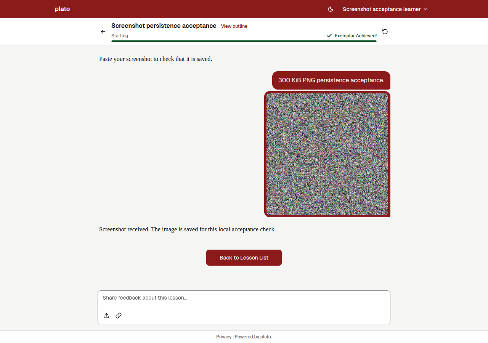

# Screenshot, token and email-off hardening verification

The combined PR covers encoded screenshot limits, refresh/reset token handling
on SQLite, DynamoDB and PostgreSQL, and truthful results when email delivery is
disabled.

Local validation on Node 24 passed: 492 client tests and 670 server tests, with
zero skips using a disposable PostgreSQL 17 instance. Lint reported zero errors
and 20 existing client warnings. The Vite client build passed.

The final review found three revocation defects: a refresh could finish across a
password reset, a DynamoDB index could omit a recent token, and unprocessed
batch deletes were ignored. Regression tests were observed failing before the
fixes and passing afterward. Refresh tokens now carry a credential fingerprint;
DynamoDB revocation uses strongly consistent table reads and bounded retries.
The route race tests use real SQLite persistence with deterministic barriers.
PostgreSQL also verifies credential persistence and concurrent token consumption
across independent connections. DynamoDB tests use an injected DocumentClient;
this is not qualification against a live AWS deployment.

## Screenshot acceptance

A synthetic PNG of exactly 307,200 bytes (300 KiB) was delivered through the
lesson composer's paste handler in Chromium. Its original data URL contained
409,622 characters. The app compressed it to 91,603 characters and persisted one
`screenshot:*` record measuring 91,773 bytes, below the 389,120-byte server limit.
The message references the screenshot by key. After reload, the image rendered
from PostgreSQL and the three-message transcript remained intact.

The preview used the production HTTP entry point with a disposable PostgreSQL
17 database. The coach response was stubbed in the browser; this check made no
live AI calls and does not qualify lesson completion or live model behavior.
The paste event was dispatched by browser automation, so this is browser
evidence, not an operating-system clipboard or physical-device check.

## Release boundaries

- D-2(a): when email is off, admin password reset creates no token or reset link.
- This verification does not deploy the branch or establish Cloud Build results.
- Production operations and live acceptance remain separate release steps.
- The review's minor copy-link feedback/fallback finding is deferred: clipboard
  denial currently provides no success/failure announcement or selectable-link
  fallback.
