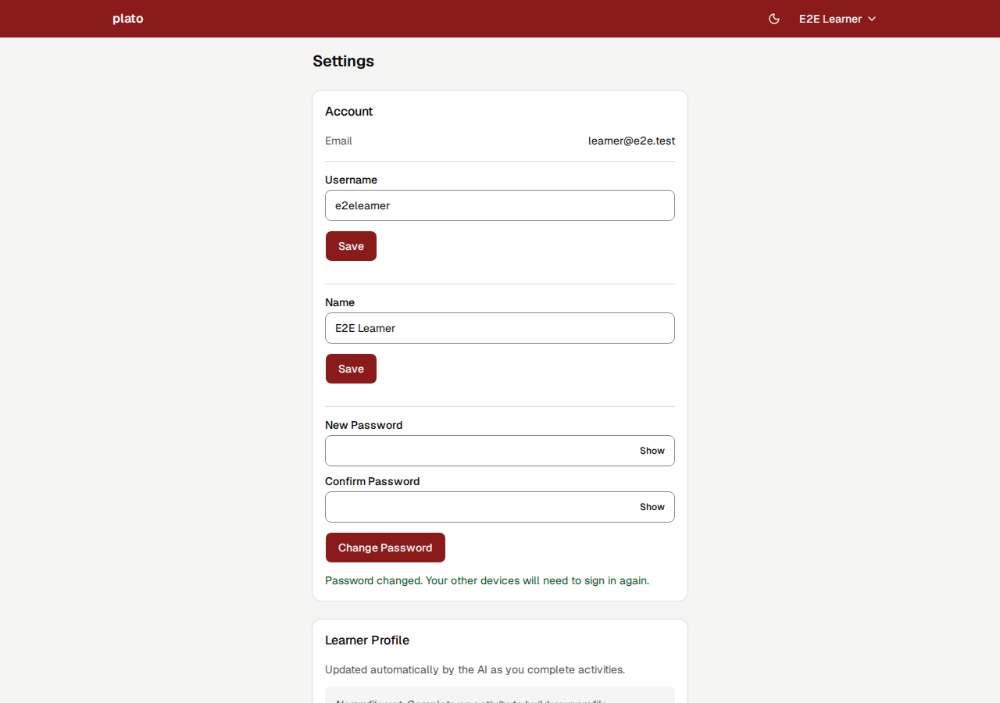
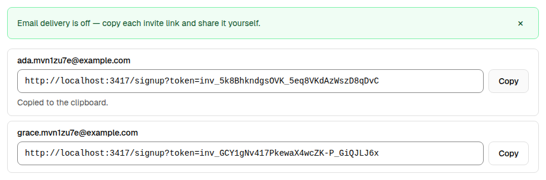
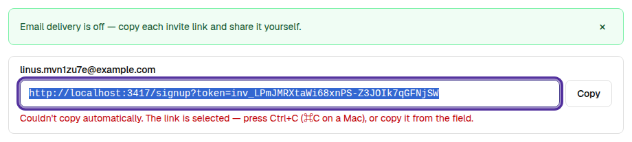
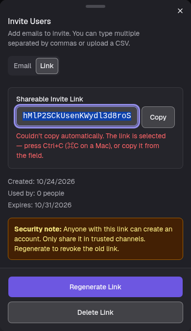

# Screenshot, token and email-off hardening verification

The combined PR covers encoded screenshot limits, refresh/reset token handling
on SQLite, DynamoDB and PostgreSQL, and truthful results when email delivery is
disabled.

Local validation on Node 24 passed: 492 client tests and 670 server tests, with
zero skips using a disposable PostgreSQL 17 instance. Lint reported zero errors
and 20 existing client warnings. The Vite client build passed. The copy-link
follow-up below is client-only. With it applied on top of the Settings fix, 500
client tests passed. The server suite passed without PostgreSQL (661 passed, 2
PostgreSQL tests skipped).

The final review found three revocation defects: a refresh could finish across a
password reset, a DynamoDB index could omit a recent token, and unprocessed
batch deletes were ignored. Regression tests were observed failing before the
fixes and passing afterward. Refresh tokens now carry a credential fingerprint;
DynamoDB revocation uses strongly consistent table reads and bounded retries.
The route race tests use real SQLite persistence with deterministic barriers.
PostgreSQL also verifies credential persistence and concurrent token consumption
across independent connections. DynamoDB tests use an injected DocumentClient;
this is not qualification against a live AWS deployment.

## Screenshot acceptance

A synthetic PNG of exactly 307,200 bytes (300 KiB) was delivered through the
lesson composer's paste handler in Chromium. Its original data URL contained
409,622 characters. The app compressed it to 91,603 characters and persisted one
`screenshot:*` record measuring 91,773 bytes, below the 389,120-byte server limit.
The message references the screenshot by key. After reload, the image rendered
from PostgreSQL and the three-message transcript remained intact.

The preview used the production HTTP entry point with a disposable PostgreSQL
17 database. The coach response was stubbed in the browser; this check made no
live AI calls and does not qualify lesson completion or live model behavior.
The paste event was dispatched by browser automation, so this is browser
evidence, not an operating-system clipboard or physical-device check.

## Settings password change

A follow-up review found that credential-bound refresh tokens signed learners
out after they changed their password in Settings. `PATCH /v1/me` changed the
password hash but issued no token bound to it, so the device's next refresh
returned 401. Before credential binding, the same change left every other
session signed in.

A password change now revokes every refresh session, including legacy tokens
without a credential fingerprint. It returns a `session` token pair bound to
the new credential, which the client saves with the refresh path's
compare-and-replace guard. The new server and client tests failed before the
change and pass after it. Validation after the change: 494 client tests and
673 server tests, zero skips, on a disposable PostgreSQL 17 instance. Lint
reported zero errors and the same 20 warnings, and the client build passed.

In Chromium against a local SQLite server, two browsers signed in as one
synthetic learner, and one changed the password in Settings. On a forced
refresh, that browser got 200 and stayed on Lessons. The other browser got
401 and returned to sign-in with the session-expired notice. The old password
was rejected and the new one accepted.

## Copy-link acceptance

The review's minor copy-link finding is fixed. Every admin copy-link action
(the per-invite links shown while email delivery is off, and the shareable
invite link) now uses `CopyLinkField`: a read-only field showing the link, a
Copy button, and a polite status region that stays mounted. `copyText`
reports whether the clipboard write resolved instead of assuming success.
When the write is denied or the Clipboard API is missing, the field is
focused and fully selected, and the status explains how to copy it by hand.

Chromium (Playwright) against the SQLite dev server with email delivery off:

- Clipboard granted: the success message appeared in the clicked link's
  status region and no other, the clipboard held exactly that link, and the
  message cleared after 4 seconds.
- Clipboard write not granted, so Chromium rejected `writeText` with
  `NotAllowedError`. Driving it from the keyboard only (Tab to Copy, then
  Enter), the failure message appeared, focus moved to the read-only field
  with the whole link selected, and Ctrl+C then put exactly the link on the
  clipboard.
- Clipboard API removed, matching an insecure context: the shareable link in
  the Invite dialog used the same fallback. Checked at 390 px in dark mode with
  no horizontal page scroll.

These checks used browser automation in headless Chromium. They did not cover
Safari, Firefox, or a physical device.

## Release boundaries

- D-2(a): when email is off, admin password reset creates no token or reset link.
- This verification does not deploy the branch or establish Cloud Build results.
- Production operations and live acceptance remain separate release steps.
