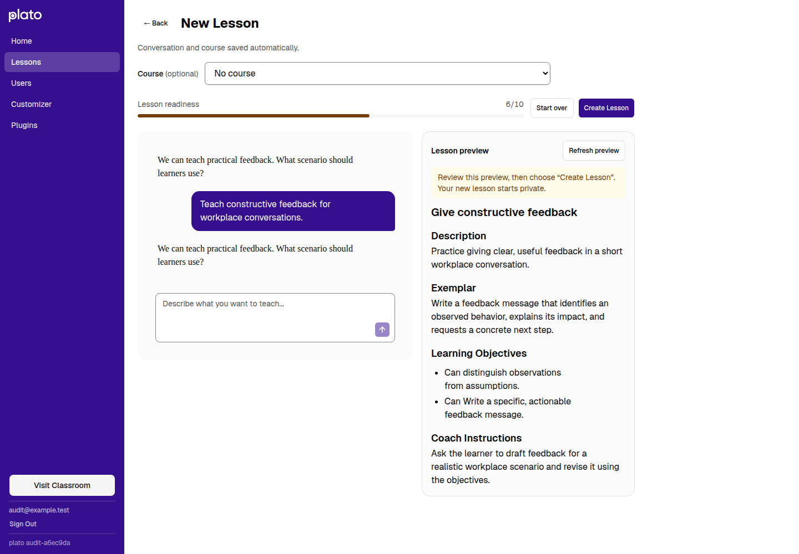
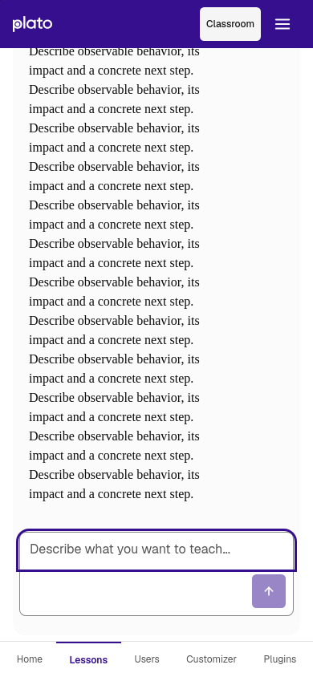
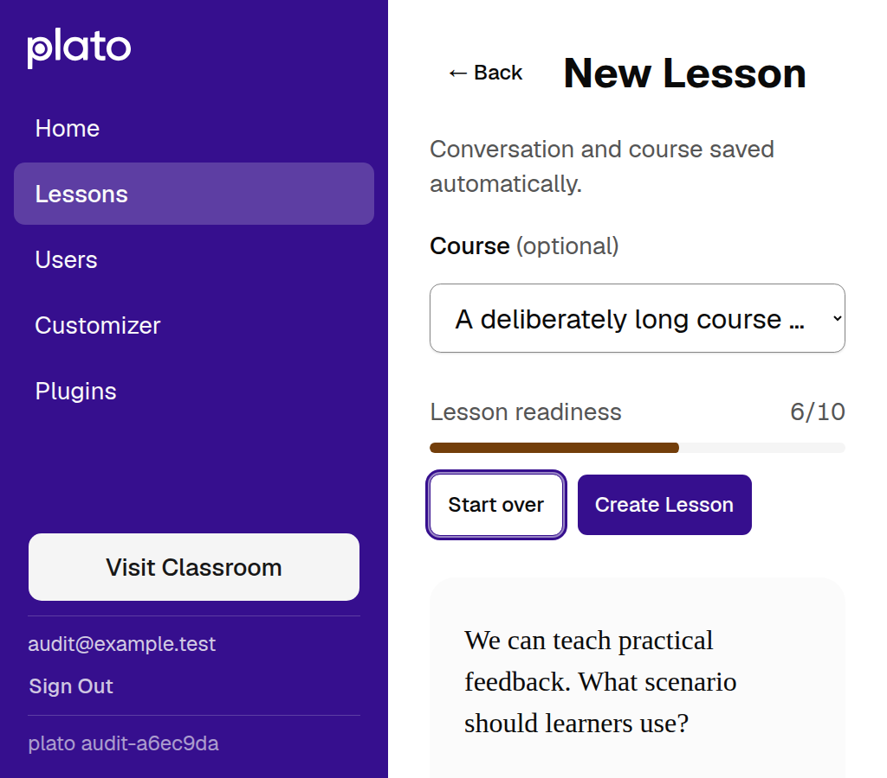

# Lesson authoring hardening, clarification and polish

The eight findings from the October 20 lesson-creation audit are addressed.
The existing conversational editor and design tokens are retained.

| Finding | Result | Evidence |
| --- | --- | --- |
| F1: load failures treated as fresh drafts | Only a confirmed missing draft starts creation; other failures offer retry | Browser 500/retry scenario; client regression |
| F2: autosave races finalization | One versioned queue, strict database CAS, operation retries, consistent DynamoDB reads | Delayed course-save/finalization browser scenario; route and both adapter tests |
| F3: preview differs from saved content | Review first, then save the exact preview; save retry does not extract again | Browser checks exact markdown and extraction count |
| F4: failed saves lose submitted messages | Account/lesson-scoped tab recovery, visible retry, Back flush and unload warning | Failed-save reload and Back browser scenarios; queue tests |
| F5: mobile send scrolls into the preview | Scroll follows the composer endpoint; reading older messages suspends following | Chromium and WebKit touch emulation |
| F6: restart retains old preview | Restart clears preview and invalidates outstanding extraction | Delayed extraction/restart browser scenario |
| F7: failed reply has no retry | Retry reuses the submitted turn; persistence retry never calls AI | Failed-reply reload/retry browser scenario; one user turn retained |
| F8: enlarged text overflows controls | Content-based columns, wrapping actions, compact padding and non-sticky actions in narrow containers | Eight viewport/text cases; measured control bounds and screenshots |

The clarification and polish pass separates conversation autosave from saving
the lesson preview. Empty, saved, stale, unconfirmed-save and rejected-preview
states now explain the appropriate next action. Readiness shows a visible score,
the course field is marked optional, and preview guidance uses readable body-small
text with consistent spacing.

Both preview controls now allow reviewing a low-readiness conversation; **creating
a lesson still requires 3/10 readiness**. A confirmed rejection offers **Revise
lesson** as the primary action. An unconfirmed save still retries the same preview,
without another extraction. Opening and reply failures have distinct guidance.

Validation:

- **813 tests pass:** 320 client, 493 server.
- Client build passes. Both ESLint commands exit successfully; client reports
  21 warnings, server reports none.
- 14 browser workflow assertions pass against synthetic, intercepted APIs.
- The follow-up adds 29 browser assertions for empty/saved/stale previews,
  matching action labels, low-readiness preview versus creation, loading,
  private creation, save retry, rejected-content revision, opening/reply failures
  and successful creation/update. No runtime exceptions or unmapped requests
  occurred during those intercepted workflows.
- Layouts checked at 1440×1000, 1024×768, 768×1024, 390×844, 320×800,
  844×390, plus 320×800 and 1024×900 with root text doubled to 32px.
  No horizontal overflow or offscreen editor controls in these cases.
- Keyboard: Enter inserts a newline, Ctrl+Enter sends, Alt+Arrow navigates
  messages from the log, Escape returns focus from the restart dialog.
- Axe reports no violations in the editor's main region on desktop Chromium
  or mobile Chromium/WebKit. Mobile editor buttons meet 44px target dimensions.
- At 390×844 after send, Chromium's composer input is at y=663–707 and WebKit's
  at y=664–708. The preview below the chat no longer pulls it offscreen.
  Both engines preserve scrollTop=0 when a reply arrives while reading above.
- Independent code review of the hardening changes found no remaining critical
  or important defects after the concurrency, recovery and validation follow-ups.

Recovery uses **sessionStorage**: it survives navigation and reload in the same
tab, not closing that tab. Conflicts require an explicit choice to discard local
work and load the saved lesson. Unknown save outcomes retain their operation for
retry; a confirmed 400 rejecting markdown permits revision.

Evidence is local browser emulation with synthetic AI/storage responses, not
physical-device or production proof. Real mobile keyboards, browser chrome,
VoiceOver/TalkBack, live Bedrock output, and deployed DynamoDB behavior were not
qualified. Full scripts, JSON measurements and logs remain under
`output/playwright/lesson-creation-hardening-2026-10-20/` and
`output/playwright/lesson-creation-polish-2026-10-20/`.

The screenshots below show the clarification and polish pass.

## Desktop



## Mobile after send

WebKit, 390×844, touch emulation. Repeated synthetic text stresses chat height.



## Enlarged text

Chromium, 1024×900, root text 32px.



## Replay the clarification checks

The [fixture](checks/fixture.js) intercepts all API calls and blocks external
requests after installation. The [workflow checks](checks/workflow.js) use
synthetic records and responses; they never call an AI provider or production
storage. Start Vite at `http://127.0.0.1:5175` and use a Playwright CLI session:

```sh
mkdir -p output/playwright/lesson-authoring-check
playwright-cli -s=lesson-authoring open about:blank
playwright-cli -s=lesson-authoring run-code --filename docs/reviews/lesson-authoring-2026-10-20/checks/fixture.js
playwright-cli -s=lesson-authoring run-code --filename docs/reviews/lesson-authoring-2026-10-20/checks/workflow.js
playwright-cli -s=lesson-authoring eval 'JSON.stringify(window.__copyResults)'
```

Use a fresh session. The workflow throws on a failed assertion; the final result
contains the 29 passing assertions and empty `errors` and `unknown` arrays.
