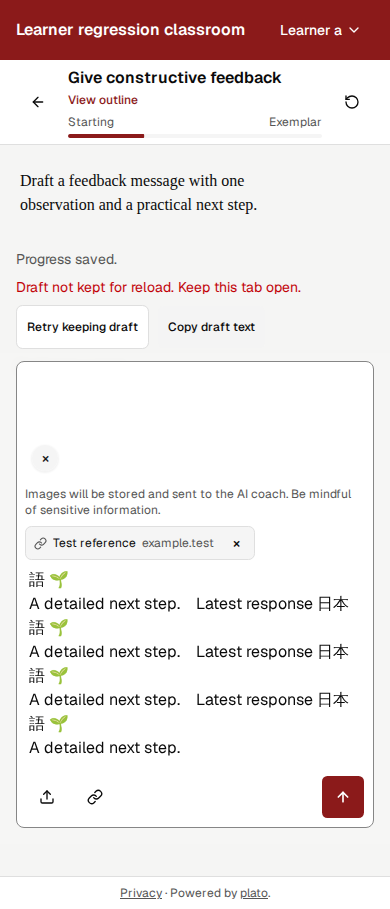
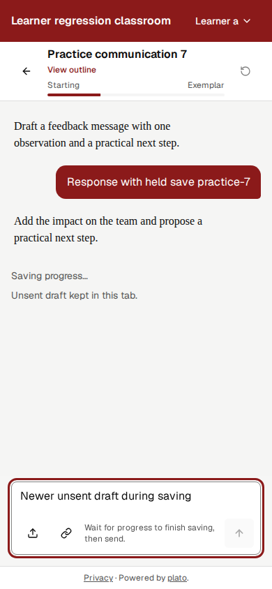

**The learner can distinguish draft retention from server saving and recover supported failures.** This publication contains the two scoped learner-recovery fixes, their regression tests, and the audit record. The original publication candidate is **B5**, isolated on `fix/learner-save-feedback` from base `8fbdac6824beed29b4050bead4b6c00e99102f43`. Later retry-navigation and reload-guard corrections, with fresh validation, are documented in the [PR #37 review follow-up](pr-37-review-2026-11-01.md); the B5 results and ledgers below remain historical evidence.

The primary checkout contained unrelated sign-in, link-focus, product documentation and test edits. Those edits are excluded. The earlier **B4** working-snapshot audit remains intact in [the detailed report](evidence/learner-recovery-2026-11-01/B4/audit-and-fix-report.md), including reproduction steps, evidence, intermediate failures and coverage. B4's 26 browser cases and geometry matrix are historical results. B5 has **23 cases per browser**, because three unrelated tests were excluded.

**F-01 · P1 — Silent loss of newer unsent drafts under storage pressure. Implemented; device verification pending.** In B1, retain an earlier draft, fill sessionStorage to native QuotaExceededError, enter newer text, then reload: the earlier draft returns without a warning. The store kept the latest value only in memory and the hook ignored the failed write. Expected behavior is explicit retention failure with a recovery path.

The store now publishes verified retention status. The lesson shows **Draft not kept for reload. Keep this tab open.**, **Retry keeping draft**, and **Copy draft text**. Readback must succeed before the warning clears. A failed copy offers text-selection guidance; copying text does not back up attachments. The controls remain in normal flow so they do not enlarge the sticky composer. B5 tests exhausted native storage, preserved newer text/image/link through navigation, freed the filler, retried, and compared the exact rich draft after reload. Ignoring the warning and closing/reloading can still lose memory-only work. Next check: native quota, interruption and tab-discard behavior in C-B5-D01.

**F-02 · P2 — Server-save pending and success were unclear. Implemented; device verification pending.** In B1, submit a response, let the coach answer, hold the real save POST, and wait for the short local-recovery notice to disappear. No explicit Saving or normal Saved state remains, while Send is disabled. Control+Enter describes waiting for the reply even though saving is the remaining operation. Expected behavior distinguishes local recovery, server pending, acknowledged success and failure.

The engine now publishes the saving phase through the existing submission store. The lesson shows **Waiting for the coach**, **Saving progress**, **Progress saved**, or **Progress not confirmed saved**, with matching early-send wording. A reopened view joins the pending request. Existing transient notices, stable turn IDs and persistence-only retries remain. In B5, a lost acknowledgment leaves one committed response; retry reconciles it with **one coach call, two save attempts and one stored response**, preserving the newer draft. Next checks: C-B5-D01/D02 and VoiceOver/TalkBack announcements in D05/D06.

**Exact publication validation.**

| Check | B5 result |
|---|---|
| Client unit tests | 709 passed |
| Chromium learner suite | 23/23 passed |
| WebKit learner suite | 23/23 passed |
| Client build | Passed; existing large-chunk advisory |
| ESLint | 0 errors; 19 existing warnings |
| Diff whitespace | Passed |

[Browser results](evidence/learner-recovery-2026-11-01/publication/chromium-checks.json), [WebKit results](evidence/learner-recovery-2026-11-01/publication/webkit-checks.json), [unit log](evidence/learner-recovery-2026-11-01/publication/client-tests.log.gz), [lint log](evidence/learner-recovery-2026-11-01/publication/client-lint.log.gz), and [source manifest](evidence/learner-recovery-2026-11-01/publication/source-manifest.json) identify the qualified candidate. Server source was not changed; the full server unit suite was not rerun.

**Environment and substitutions.** Mobile Web UX Runner **2.0.7**, Impeccable **4.8.0**, Node **24.21.0**, and Playwright **1.61.1**. Execution used Linux desktop Chromium **149.0.7827.55** and Playwright WebKit **26.5** with mobile emulation. WebKit is not actual Safari/iOS. Real local authentication, Hono routes and disposable SQLite transactions ran with synthetic accounts/lessons. AI and URL extraction were deterministic fixture substitutes; Firebase build configuration was synthetic; outside network and email were disabled. Held requests continued to the fixture on release; lost-ack cases committed SQLite before aborting the response. Native storage exhaustion and separate silent-write failure were tested. Clipboard success/failure was substituted. Cloud Run/Cloud SQL, live providers, OAuth/email, OS clipboard, native keyboards and physical devices remain untested.

**Coverage retained from the audit.** All seven Runner modules and ten master areas remain recorded. B4 measured 72 states per engine across 320/360/390/430px, 844×390 landscape, enlarged root-font proxies, light/dark and desktop control; no horizontal overflow or unreachable enabled actions remained. This matrix has not been relabeled as B5 evidence.

| Master area | Evidence and disposition | Remaining |
|---|---|---|
| Reach and placement | B4 layout/hit tests; B5 recovery actions | Physical reach and keyboard |
| Viewport and safe areas | B4 standard widths/short landscape; source handling unchanged | Real chrome, insets and keyboard |
| Touch targets | B4 geometry and Chromium direct activation | Real touch; WebKit wheel probe unavailable |
| Forms and keyboard | F-01 implemented; B5 exact rich-draft retry/reload | IME, autofill, software keyboard |
| Gestures and scrolling | Recorded navigation and proxy controls | Native gestures |
| Overlays and navigation | B4 outline/Escape; B5 late-request and reopen recovery | Android Back and Safari toolbar variants |
| Content priority | Lesson, coach and actions retained; explicit state feedback | Actual enlarged OS text |
| Performance | Original B1 lab concern retained as recommendation | Attributed production-equivalent trace |
| Errors and recovery | F-01/F-02 implemented; B5 quota, readback, 503, lost ack and retry | Native interruption and service behavior |
| Mobile accessibility | Named actions/live regions, keyboard retry and copy fallback | VoiceOver and TalkBack |

**Recommendations remain separate from defects.** R-01's tab-lifetime explanation is implemented as supporting copy; cross-session draft sync remains a separate product decision. R-02 remains an investigation: attribute the original throttled load/shift signal before changing performance behavior. No performance or device-dependent fix was applied.

**Six device checks remain NOT READY.** [The current B5 script](evidence/learner-recovery-2026-11-01/publication/device-checks.md) gives exact prerequisites, state-specific steps/outcomes, separate build/setup confirmation and stop conditions. It replaces the B4 reservations without counting any device check as executed. Needed: a phone-reachable build, synthetic fixtures, exact actual devices/OS/browser versions and documented delay/failure controls.

| ID | Proposed configuration | Focus |
|---|---|---|
| C-B5-D01 | iPhone 15, Safari bottom tabs; exact versions unknown | Retention, quota, interruption and saved return |
| C-B5-D02 | Pixel 8, Chrome Android; exact versions unknown | Composer, Android Back and recovery |
| C-B5-D03 | iPhone 15, Safari bottom tabs; exact versions unknown | Keyboard, safe areas and reach |
| C-B5-D04 | iPhone 15, Safari top tabs; exact versions unknown | Toolbar geometry |
| C-B5-D05 | iPhone 15, compact Safari with VoiceOver; exact versions unknown | Enlarged text and spoken feedback |
| C-B5-D06 | Pixel 8, Chrome with TalkBack; exact versions unknown | Larger text, recovery and status announcements |

The [publication ledger](evidence/learner-recovery-2026-11-01/publication/run.json) retains the earlier builds, original failures and replacement IDs. The [B4 ledger](evidence/learner-recovery-2026-11-01/B4/run.json) is preserved unchanged. Runner status remains valid but incomplete: **Implemented**, not target-verified. Historical diagnostic records retain their original absolute local paths as provenance; the linked representative evidence is bundled here.

No merge or deployment is included in this publication. The primary checkout and its unrelated work remain protected.
