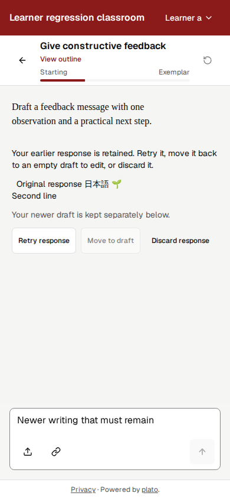
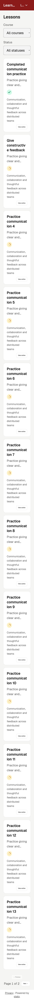

# Pending-work integration qualification — 2026-10-26

This integration preserves the browser CI gate (PR22), coach assessment/receipt contract (PR25), Customizer and branding followups (PR23), and remaining learner submission/settings recovery work. Original source commit ancestry is retained. The newer main Markdown parser, Customizer save acknowledgement, bounded draft requests and public footer behavior remain present.

## Combined behavior

- Submitted learner input survives interrupted generation separately from newer editable drafts. Saves retry the same generated identity, and explicit dismissal prevents that exact server-recovered turn from reappearing after reload.
- Profile and course enrichment stay bound to the originating account across queued work, late model bodies, cache reads and persistence. Settings accepts a valid no-change profile result without unnecessary writes or retries.
- Branding updates remain transactional across SQLite, PostgreSQL and DynamoDB, with partial field updates, bounded logo processing, legacy-logo recovery and accessible Customizer retry behavior.
- Coach assessment uses server-authorized lesson criteria and signed receipts. Literal control-looking text inside tilde, longer backtick and indented/CRLF fences stays visible and does not become assessment metadata.

## Verification

| Check | Result |
| --- | --- |
| Client node:test suite | 678 passed, zero failures/skips |
| Server node:test suite | 836 passed, zero failures/skips; real disposable PostgreSQL 17 included |
| Plugin tests and manifests | 6 passed; all 3 manifests valid |
| Lint | Zero errors; 20 warnings already present on main |
| Production client build | Passed; existing large-chunk warning |
| Admin browser suite | Chromium: 15 passed |
| Customizer browser suite | Chromium, WebKit, Firefox: 26 passed each |
| Learner recovery/browser suite | Chromium, WebKit: 13 passed each |

The 119 browser cases use isolated local fixtures and synthetic accounts. They exercise real application routing and SQLite persistence with deterministic inference responses. They are browser-engine evidence, not physical-device or live-model qualification. DynamoDB transaction construction/contracts are tested; a live AWS database was not exercised.

One independent whole-branch review found four Important issues: background account isolation, discarded recovery resurrection, valid no-change feedback, and Markdown fence scanning. Each was reproduced before its fix and then passed its focused regression. The complete client/server suite and six browser runs passed after the fix pass. No Critical or Minor findings were raised. A suspected custom-field overwrite was withdrawn after confirming that the existing read-only controls prevent edits during saving.

## Representative rendered states

## Release boundary

GitHub Actions are billing-blocked as documented in AUTOMATION.md. Cloud Build is the hosted CI/deployment lane. The browser gate in this branch must also be copied into the live plato-main trigger before publication; a checked-in YAML file alone does not change the inline trigger. Publication and live release verification are recorded separately from the local checks above.

Live provider teaching quality, physical-device/assistive-technology checks, and optional enrichment backfill after recovery remain outside this reconciliation. Upstream dependency/feature candidates require separate evaluation and changes.
