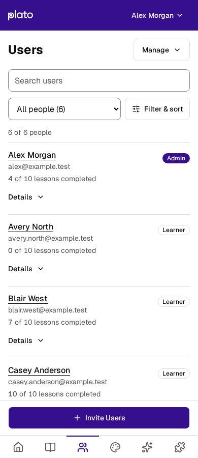
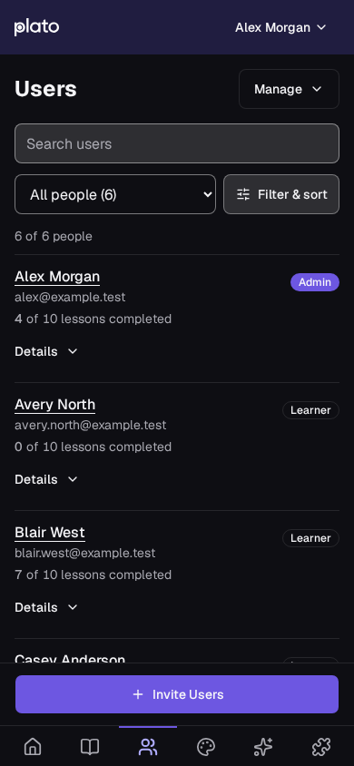
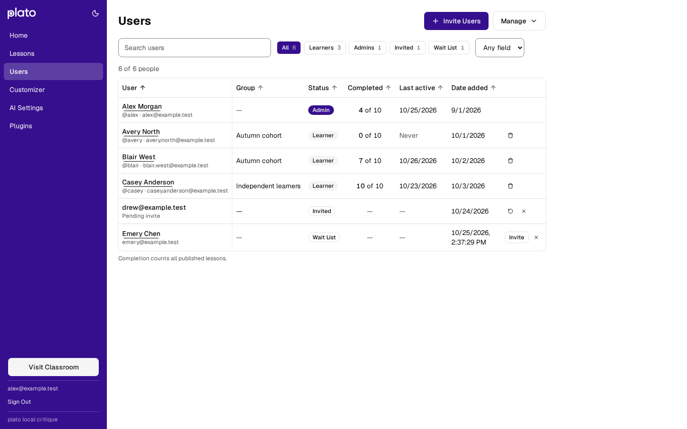
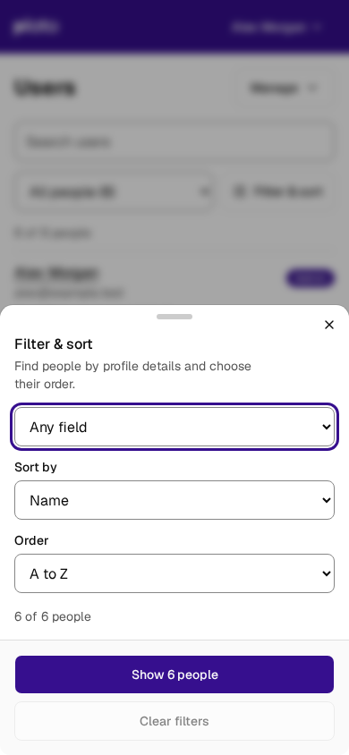
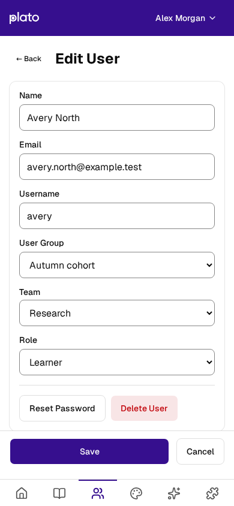

# Users mobile adaptation — 2026-10-26

The Users directory now uses a compact list below 768 px. Name, email, status, and completed lesson counts are visible without horizontal scrolling. Details reveal secondary fields and destructive actions. Search and status remain on the page; custom-field filters and sorting share a sheet. Invite and editor actions sit above the existing navigation, with controls that wrap when text grows. Desktop retains its sortable table and the existing plato identity.

Motion is scoped to sheet arrival (220 ms), the Details chevron (180 ms), feedback fading (150 ms), and the success check (320 ms). Reduced motion removes travel, rotation transitions, and check drawing. Rows and route changes remain immediate.

Save and invitation controls retain keyboard focus while pending and reject repeated activation. Account fields become read-only during saving. Failed email invitations remain beside Send with the queued addresses available for retry. Wait-list editor failures remain visible in that editor. Empty custom-field results explain the active filter and offer Clear filters. Completion is a neutral count of all published lessons, including in the activity panel. The mobile Details entry labels this denominator as **Lesson scope**, while the actual count remains visible above the disclosure.

## Validation

- `npm run build:client` passed (existing main-chunk size warning).
- `npm test` passed: 678 client tests and 863 server tests; 3 server tests skipped by their existing environment gates.
- `npm run lint` passed with 20 existing client warnings and no errors.
- `npm --prefix client run test:browser:admin` passed all 22 tests. The merged branch was rebuilt and all 22 checks were rerun after reconciling the shared stylesheet with main.
- Browser checks cover 320, 390, 640, 768, 1280, and 1440 px layouts; light/dark themes; 844×390 landscape; 150% and 200% root text; keyboard editing and focus return; realistic touch swipes; reduced motion; pagination/filter recovery; pending duplicate submissions; invitation failure and retry; and focus recovery when inviting removes a wait-list row.

Screenshots use the local production build and synthetic users with intercepted API responses. No real email or Slack invitations were sent. Touch and layout validation used Chromium emulation; physical iOS/Android devices and Safari were not available. This is implementation evidence, not a complete accessibility conformance audit.

## Screenshots

| Phone | Dark theme |
| --- | --- |
|  |  |

| Filter and sort sheet | Account editor |
| --- | --- |
|  |  |
