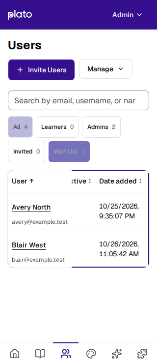
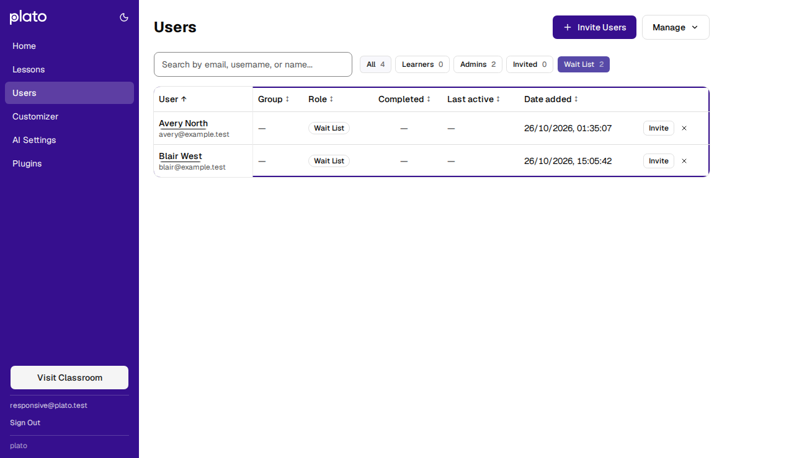

# Waitlist timestamps qualification

Waitlist rows in Admin → Users now display the viewer's local date and time,
including seconds. The timestamp wraps when necessary so the sticky user column
does not conceal it on a narrow screen. Existing users and pending invitations
retain their date-only display; sorting continues to use the original timestamp.

The browser regression supplies two synthetic entries through the waitlist API
boundary while using the real built application, SQLite server, authentication,
and remaining admin endpoints. It checks literal expected strings in `en-US` /
`America/New_York` and `en-GB` / `Europe/London`, at widths of 320 and 1280 pixels.
The first UTC timestamp falls on the previous calendar date in New York; both
entries fall on the same local date in London and remain distinguishable by time.

The new assertion failed against the date-only implementation. Changing only the
format then exposed text hidden behind the sticky user column at 320px. Allowing
the waitlist date cell to wrap made both assertions pass. The regression also
checks keyboard scrolling, visible text bounds, and document width.

Validation on 2026-10-26 with Node 24.21.0:

- `npm test`: 696 client tests and 836 server tests passed, with no skips. These
  include 18 Firestore emulator rules cases and the real PostgreSQL suite.
- `npm run lint`: no errors; 20 pre-existing warnings.
- `npm run build:client`: passed; existing large-chunk warning remains.
- `npm --prefix client run test:browser:admin`: all 16 tests passed in Chromium.
- `npm audit`: zero reported vulnerabilities. Vite resolves to 8.3.5 and every
  installed `@grpc/grpc-js` resolves to 1.14.6.

These are local code and browser-render checks with synthetic records. They do
not establish physical-device, assistive-technology, live OAuth, or production
Firestore behavior.

